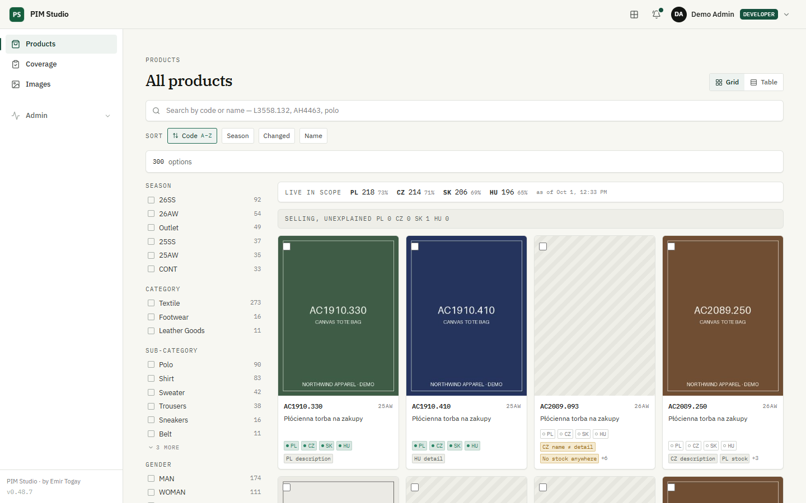
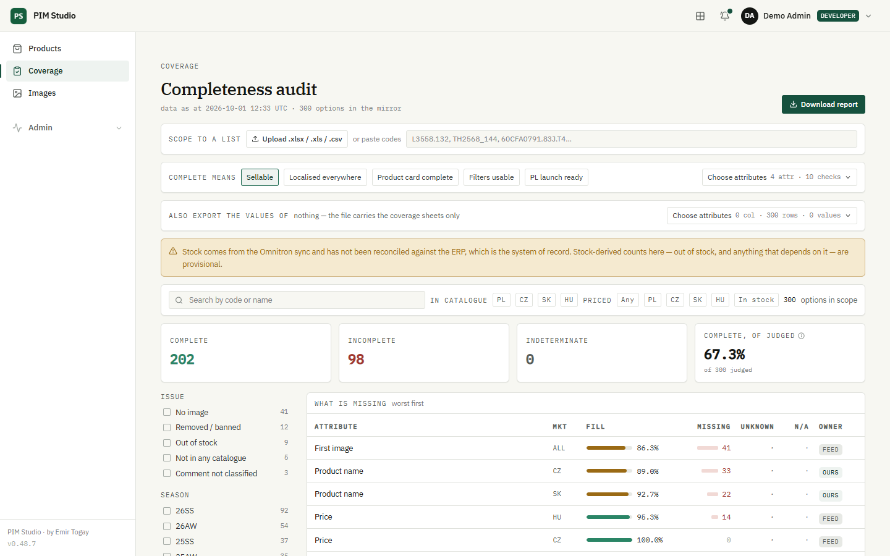
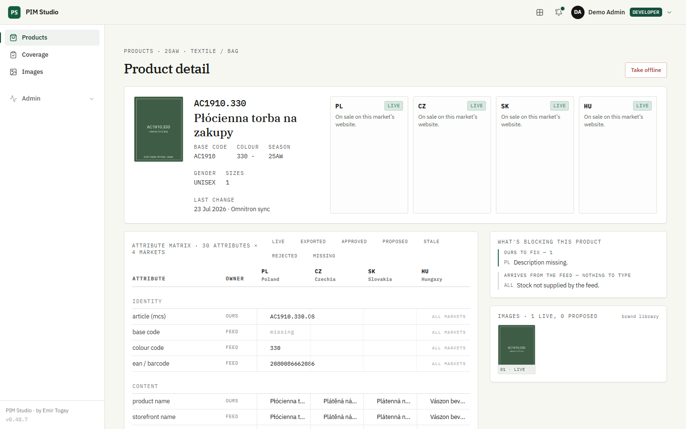
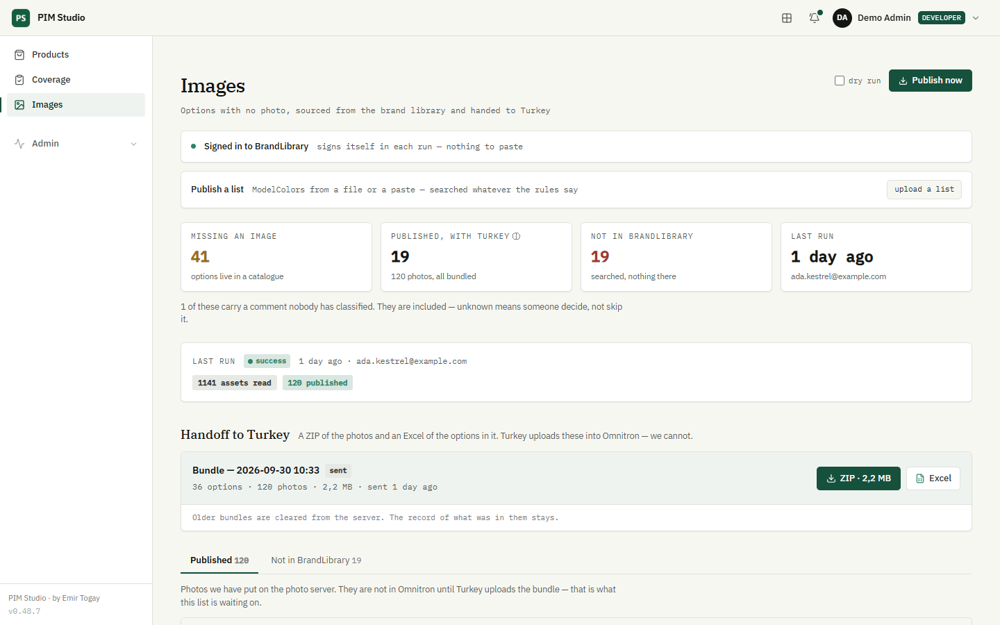
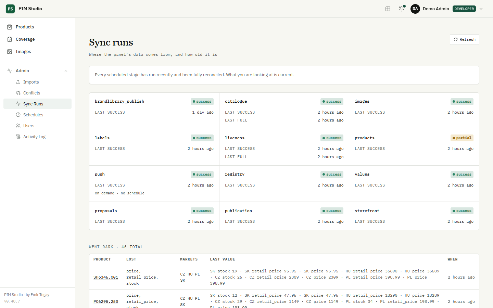
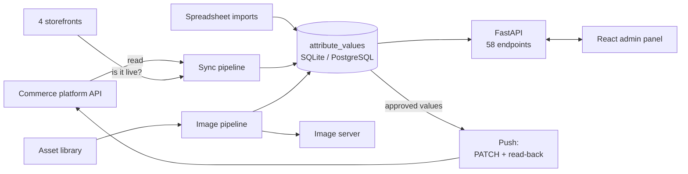

# PIM Studio

**Product information management for a fashion e-commerce business that sells in four countries.**
It shows what every product is missing before it can be sold, gets the fixes approved, writes them back to
the commerce platform, and runs the product-photo pipeline, with a full audit trail of who changed what.

[](https://github.com/emirtogay/pim-studio/actions/workflows/ci.yml)




## At a glance

- **Real software, in production.** I designed and built it for the e-commerce team of a fashion retailer,
  where it runs their product data across four markets (Poland, Czechia, Slovakia, Hungary).
- **End to end, on my own:** working out the problems with the team, the data model, backend, frontend, tests
  and deployment.
- **Size:** about 30,000 lines of Python and 15,000 of TypeScript; 1,200+ automated tests; 58 API endpoints;
  13 screens; 23 database migrations.
- **Safe to explore.** This public copy uses an invented brand, *Northwind Apparel*, and replaces every outside
  system with a mock. It runs on a laptop with no accounts, keys or network.

## The problem it solves

A fashion brand selling online in several countries has thousands of products. Each product needs dozens of
attributes in every market (translated names, materials, care instructions, sizes, prices, photos) before
it can go on sale. The data comes from several places that disagree with each other, and the commerce platform
only tells you what it holds, not what is missing or why.

PIM Studio answers three questions every morning:
1. **What is missing, and whose job is it?** Gaps per product and market, scoped by season or category, with
   the owner of each gap.
2. **Is the fix safe to send?** Every change is proposed, approved by a named person, then pushed. Each write
   is read back to confirm it landed.
3. **Can a customer actually see it?** A product counts as live only once its page on the real shop shows it.

## Features

| Area | What it does |
|---|---|
| **Coverage** | Shows what is missing, on how many products, and whose desk it lands on. Requirements can be set per market; results can be scoped by season, category or a pasted list of codes. |
| **Products** | One page per product and colour: every attribute in every market, where each value came from, and its state. |
| **Imports and pushing** | Edits made in the panel or in a spreadsheet are approved with a name on them, then pushed to the platform one size at a time. |
| **Conflicts** | When two sources disagree, a person decides. Nothing is overwritten silently. |
| **Takedowns** | Takes products off a market's catalogue, and shows everything affected before the click. |
| **Images** | Finds products with no photos, picks the right images from the brand's asset library, publishes them to the image server, and records each URL. |
| **Runs, users, activity** | A history of every pipeline run, three permission levels, and an audit log of every change and sign-in. |

| | |
|---|---|
|  |  |
|  |  |

## Try it

With Docker:

```bash
git clone https://github.com/emirtogay/pim-studio.git
cd pim-studio
docker compose up --build
```

The first start takes a couple of minutes while the demo database is built.

Without Docker (Python 3.12+ and Node 20+):

```bash
git clone https://github.com/emirtogay/pim-studio.git
cd pim-studio
python -m venv .venv
source .venv/bin/activate            # Windows: .venv\Scripts\activate
pip install -e ".[dev]"
cd src/pim_studio/admin/frontend
npm install
npm run build
cd ../../../..                       # back to the repository root
export DEMO_MODE=1                   # Windows PowerShell: $env:DEMO_MODE=1
python -m pim_studio.demo.seed       # builds the demo database, about a minute and a half
uvicorn pim_studio.admin.app:app
```

Then open http://localhost:8000.

Sign in with **demo / demo**. Demo mode is one setting (`DEMO_MODE=1`). The commerce platform, the asset library,
the FTP image server and the four storefronts are each replaced by a mock serving the same invented catalogue.
The data on screen was produced by the app's own sync pipeline running against those mocks, so every page shows
the real code paths.

## How it is built



**Backend:** Python 3.12, FastAPI, SQLAlchemy 2, Alembic, pydantic-settings, httpx, APScheduler, structlog,
argon2.
**Frontend:** React 18, TypeScript (strict), Vite, Tailwind CSS, React Router.
**Quality:** pytest, ruff, GitHub Actions.
**Deployment:** Docker.

### The data model

The centre of the schema is not a `products` table but `attribute_values`: one row for each product, attribute
and market. Each row holds the value, where it came from, and where it is in its life:

```
missing → proposed → approved → exported → live
                  ↘ rejected              ↘ stale
```

- **Attributes are rows, not columns.** New fields arrive every season, so a fixed schema would break on first
  contact.
- **The market is part of the key**, never a suffix on a column name. The platform's own suffixes are
  inconsistent (`_pl` and `_pol`), so every source column is mapped to an (attribute, market) pair explicitly.
- **`missing` is computed, never stored.** An absence is a fact about the requirements, not a row.

### Engineering decisions worth a look

- **An absent source is not an empty value.** If a column is missing from an export, that says nothing about the
  value behind it. Treating the two as the same produces confident, plausible, wrong numbers. So coverage has four
  verdicts: `met`, `missing`, `unknown` (no source we read could hold it) and `na` (not applicable). `unknown`
  never counts as either a gap or a pass.
- **Writes are off by default.** The platform client refuses every write unless the server enables writes. A push
  is a partial `PATCH` keyed on the product's primary key, so it cannot touch fields it did not mean to change.
  Each size is compared before the write and read back after it, and the run stops at the first surprise.
- **Whatever writes, commits.** A test covers every endpoint that changes data. It reads the change back through
  a fresh database session and requires an audit row, so a change that returns 200 but was rolled back cannot
  ship ([`tests/test_admin_durability.py`](tests/test_admin_durability.py)).
- **One identifier, five spellings.** The same product code is written with a dot in one system, an underscore
  in another, and split over two columns in a third. All are normalised on read by one function, and the
  exceptions are rules in [`rules/identifiers.py`](src/pim_studio/rules/identifiers.py), not special cases
  scattered through the code.
- **One switch for every outside system.** [`integrations.py`](src/pim_studio/integrations.py) hands out the
  platform client, the asset-library client, the image server and the HTTP client for storefront checks. In demo
  mode each one is a mock from [`demo/`](src/pim_studio/demo/). Nothing else in the code knows the difference.

## Project layout

```
src/pim_studio/
  models.py            the schema
  seed.py              attribute registry, column map, vocabularies, ban list
  integrations.py      the single switch between real integrations and the demo mocks
  demo/                mock platform, asset library, image server and storefronts; demo catalogue and seed
  rules/               liveness, ban list, coverage, identifiers, language
  reports/             read-only questions answered from the tables
  omnitron/            commerce-platform client: every write shut unless enabled
  sync/                the inbound pipeline; push.py is the outbound half
  brandlibrary/        the photo pipeline: asset library, FTP, hand-off bundles
  admin/
    app.py             FastAPI app, routers split by domain
    auth.py audit.py   argon2 passwords, three role tiers, signed session cookie, audit log
    frontend/          React 18 · Vite · TypeScript strict · Tailwind
migrations/            Alembic
tests/                 pytest; every outside system is faked
```

## Tests

1,224 tests pass, covering the sync pipeline, the push, the photo pipeline, the API and the demo mode itself.

```bash
pip install -e ".[dev]"
ruff check src tests
pytest -q
```

The tests need no network, Docker or database server. Each test gets its own SQLite file, and every outside
system is faked at the HTTP or client level.

## About

Built by **Emir Togay** ([GitHub](https://github.com/emirtogay)). This repository is a cleaned public copy of a
private production codebase: the brand, hosts, people and product data are invented, and the code and tests are
the real thing. Code comments sometimes cite "the vault" (the project's design notebook: decision log, API
findings) or the production deploy scripts; both stay private.

Licensed under MIT; see [LICENSE](LICENSE).
